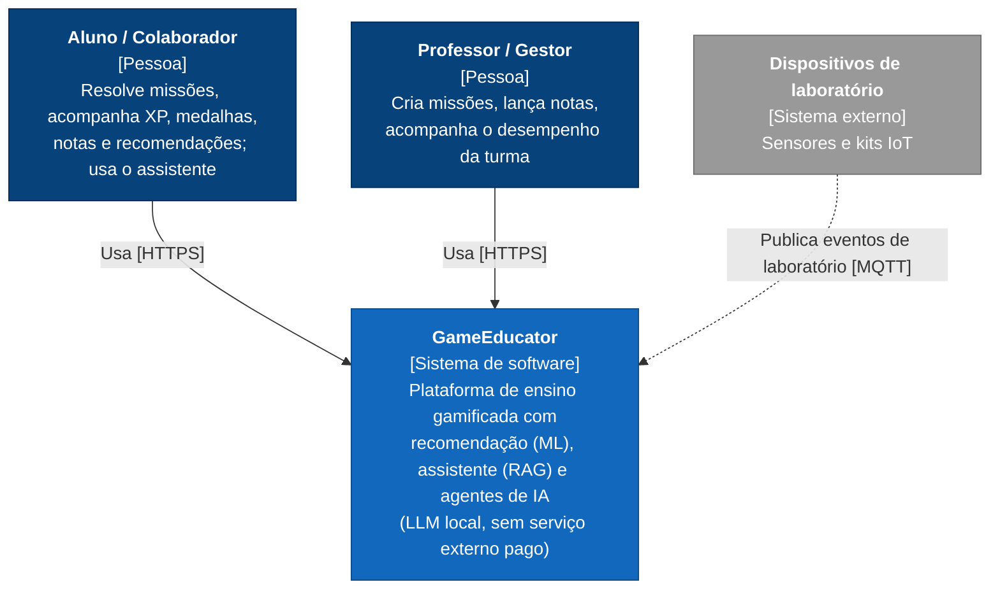
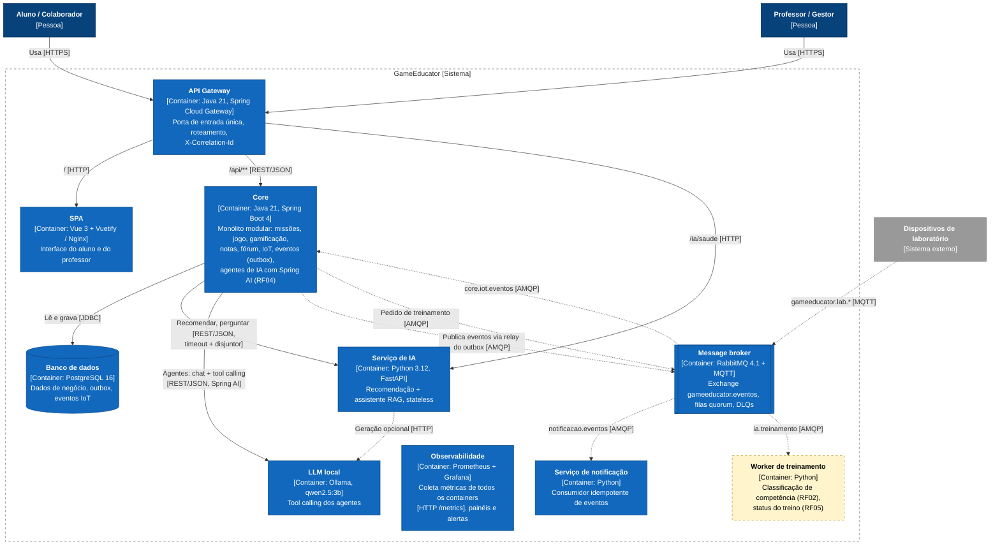
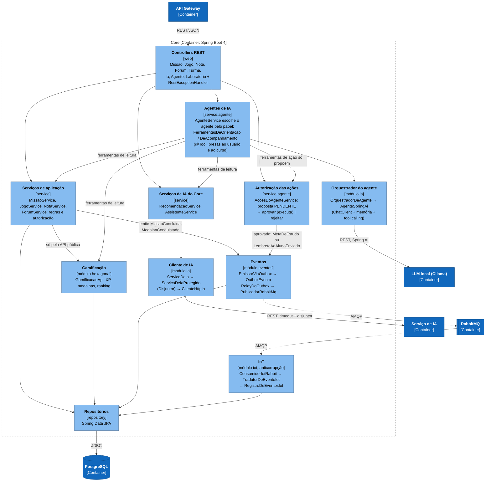
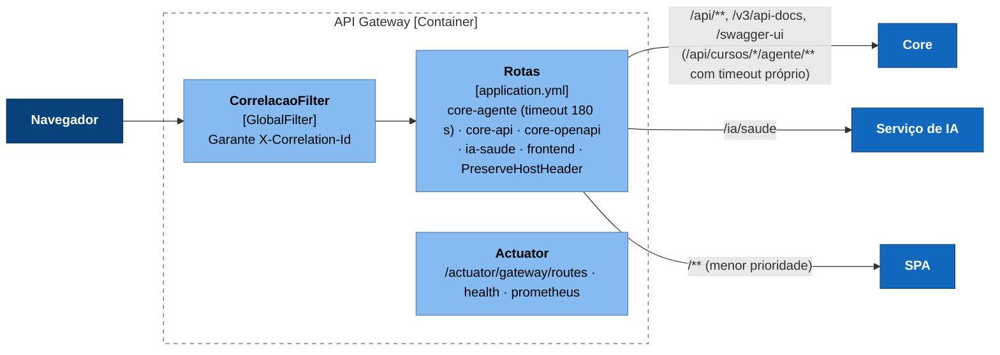
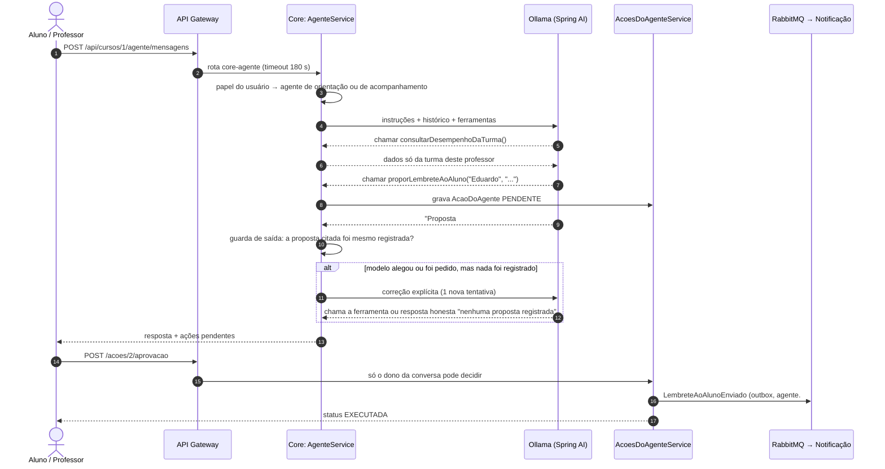
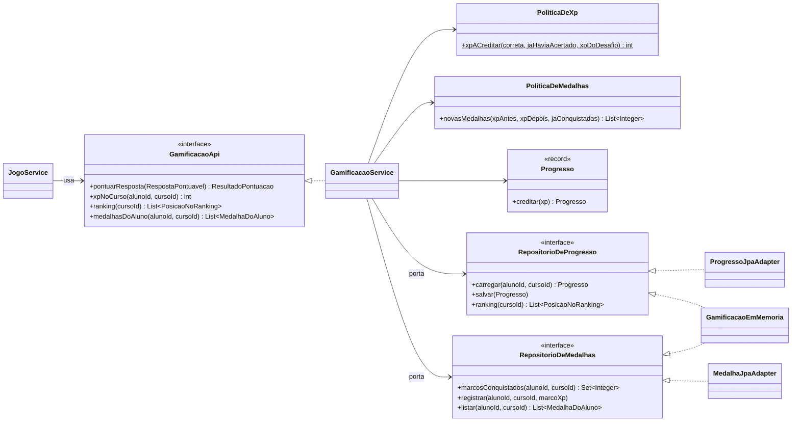
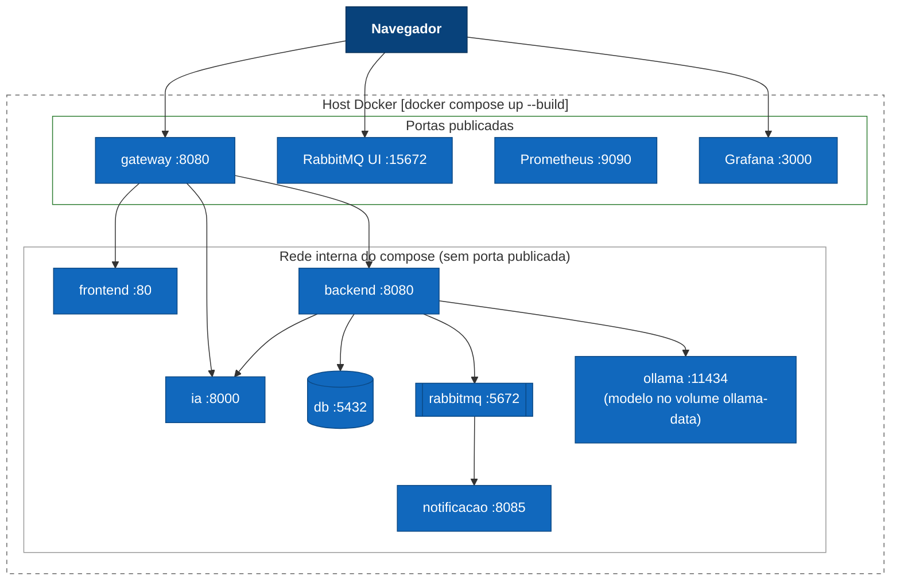

# GameEducator - Backend

API REST do GameEducator, plataforma de ensino gamificada (cursos, missões, desafios, XP, notas e fórum).
O frontend fica no repositório [gameeducator-frontend](https://github.com/IHPNULL/gameeducator-frontend).

**Stack:** Java 21 · Spring Boot 4 (Web + Data JPA) · H2 / PostgreSQL · JUnit 5 · JaCoCo

**Integrantes (Grupo 6):** Italo Haas Pascoli (190294) · Maria Eduarda Mota Zandonade (200953)

## Executar a plataforma completa (AF)

Na raiz deste repositório, um único comando sobe tudo:

```bash
docker compose up --build
```

Abra **http://localhost:8080**. O API Gateway (Spring Cloud Gateway, pasta [`gateway/`](gateway/)) é a única porta de entrada:

| Caminho no gateway | Destino | Container |
|---|---|---|
| `/` (e qualquer rota da SPA) | Frontend Vue 3 servido pelo Nginx | `frontend` |
| `/api/**` | API REST do Core | `backend` |
| `/swagger-ui.html`, `/v3/api-docs` | Documentação OpenAPI do Core | `backend` |
| `/ia/saude` | Saúde do serviço de IA | `ia` (FastAPI) |
| `/actuator/gateway/routes` | Rotas ativas do gateway | `gateway` |

O gateway também carimba um `X-Correlation-Id` em toda requisição e o devolve na resposta. Core, IA, PostgreSQL e o consumidor de notificação não publicam portas: ficam só na rede interna do compose. As outras portas publicadas são 15672 (RabbitMQ UI, `gameeducator`/`gameeducator`), 9090 (Prometheus) e 3000 (Grafana).

- O frontend e a IA são buildados direto do branch `main` dos repositórios no GitHub, então basta clonar este repositório. Para buildar a partir dos clones locais, copie `.env.example` para `.env`.
- Se a porta 8080 estiver ocupada, use `GATEWAY_PORT=8088 docker compose up --build`.
- Para parar e apagar os dados: `docker compose down -v`.

## Arquitetura C4

Documentação da arquitetura no modelo C4, do nível mais amplo ao mais detalhado: **1. Contexto → 2. Containers → 3. Componentes → 4. Código**, mais a visão de **implantação** (limites do `docker compose`).

**Legenda:** 🟦 azul escuro = pessoa · 🟦 azul = container/componente existente · ⬜ cinza = sistema externo · 🟨 tracejado amarelo = **a implementar na AF** (requisitos novos; atualizar a legenda quando estiver pronto) · linha cheia = síncrono (REST/HTTP) · linha tracejada = assíncrono (AMQP/MQTT) ou opcional.

### Nível 1 — Contexto do sistema

Quem usa o GameEducator e com que sistemas externos ele conversa.



### Nível 2 — Containers

Os processos que compõem o sistema, as tecnologias de cada um e como se comunicam. Todos sobem com `docker compose up --build`.



| Container | Repositório | Tecnologia | Responsabilidade |
|---|---|---|---|
| API Gateway | `gameeducator-backend/gateway` | Spring Cloud Gateway | Única porta exposta; roteia SPA, API e IA |
| SPA | `gameeducator-frontend` | Vue 3, Vuetify, Nginx | Telas do aluno e do professor |
| Core | `gameeducator-backend` | Spring Boot 4, JPA | Regras de negócio, autorização, outbox |
| Serviço de IA | `gameeducator-ia` | FastAPI | Recomendação e assistente RAG, sem acesso ao banco |
| Banco de dados | — | PostgreSQL 16 | Persistência do Core |
| Message broker | `gameeducator-backend/labs/infra` | RabbitMQ 4.1 (AMQP + MQTT) | Eventos assíncronos e IoT |
| Serviço de notificação | `gameeducator-backend/labs/notificacao-consumidor` | Python, pika | Consome eventos de domínio |
| Observabilidade | `gameeducator-backend/labs/infra` | Prometheus, Grafana | Métricas, painéis e alertas |
| LLM local | imagem `ollama/ollama` (modelo baixado pelo `ollama-modelo`) | Ollama, qwen2.5:3b | Modelo dos agentes de IA (RF04) |

**Comunicação entre containers**

| Interação | Estilo | Por quê |
|---|---|---|
| Navegador → Gateway → SPA / Core | Síncrono (REST) | O usuário espera a resposta na tela |
| Core → Serviço de IA (recomendar, perguntar) | Síncrono (REST) com timeout de 2 s, disjuntor e fallback | A resposta é necessária na hora; a IA fora não pode travar o Core (ADR-B1-003) |
| Core → RabbitMQ → Notificação | Assíncrono (AMQP via outbox) | Notificar é eventual; a falha do consumidor não pode desfazer a conclusão da missão (ADR-B1-004) |
| Core → Ollama (agentes, RF04) | Síncrono (REST) com timeout de 180 s só na rota do agente | O usuário está esperando a resposta do chat; com o LLM fora, o agente responde 503 e o resto segue |
| Lembrete aprovado → RabbitMQ → Notificação (RF04) | Assíncrono (AMQP via outbox, routing key `agente.#`) | A aprovação conclui na hora; a entrega ao aluno é eventual e sobrevive ao consumidor fora |
| Dispositivos → RabbitMQ → Core | Assíncrono (MQTT → AMQP) | Dispositivos com conectividade intermitente; o broker absorve picos (ADR-B1-005) |
| Core → RabbitMQ → Worker de treinamento 🟨 | Assíncrono (AMQP) | Treinar é demorado; o pedido fica na fila enquanto o ML estiver fora (RNF02) |

### Nível 3 — Componentes

#### Core (Spring Boot)

Monólito modular em camadas (`web → service → repository → domain`), com módulos de fronteira verificada pelo ArchUnit (`ArquiteturaModularTest`). A gamificação é hexagonal (ADR-B1-002); IA, eventos e IoT ficam atrás de portas com adaptadores trocáveis.



#### Serviço de IA (FastAPI)

```mermaid
flowchart TB
    core["<b>Core</b><br/>[Container]"]:::container
    gw["<b>API Gateway</b><br/>[Container]"]:::container
    llm["<b>Provedor de LLM</b><br/>[Sistema externo, opcional]"]:::externo

    subgraph ia["Serviço de IA [Container: FastAPI]"]
        api["<b>API HTTP</b><br/>[app/main.py]<br/>POST /recomendacoes · POST /assistente/perguntas<br/>GET /saude · GET /metrics"]:::componente
        rec["<b>Modelo de recomendação</b><br/>[app/recomendacao/modelo.py]<br/>Pontuação versionada (MODELO_VERSAO)"]:::componente
        ret["<b>Recuperação (R do RAG)</b><br/>[app/assistente/recuperacao.py]<br/>TF-IDF + cosseno sobre o material do curso"]:::componente
        gen["<b>Geração (G do RAG)</b><br/>[app/assistente/geracao.py]<br/>Extrativo (padrão) ou Ollama, com fallback"]:::componente
        met["<b>Métricas</b><br/>[app/metricas.py]<br/>Prometheus"]:::componente
        clf["<b>Classificador de competência</b><br/>[scikit-learn] (RF02)"]:::planejado
    end

    core -->|"REST/JSON"| api
    gw -->|"/ia/saude"| api
    api --> rec & ret & met
    ret --> gen
    gen -.->|"HTTP"| llm
    api -.-> clf

    classDef container fill:#1168bd,stroke:#0b4884,color:#fff
    classDef componente fill:#85bbf0,stroke:#5d82a8,color:#000
    classDef externo fill:#999999,stroke:#6b6b6b,color:#fff
    classDef planejado fill:#fff4cc,stroke:#b38f00,color:#000,stroke-dasharray:5 5
    style ia fill:none,stroke:#666,stroke-dasharray:5 5
```



#### API Gateway (Spring Cloud Gateway)



### Fluxo do RF04 — agentes de IA com autorização do usuário

O agente lê dados com ferramentas presas ao usuário e ao curso da requisição (o modelo escolhe *qual* ferramenta, nunca *sobre quem*: RNF03) e **só propõe** ações. Nada muda sem a aprovação do próprio usuário.



| Agente | Quem usa | Ferramentas de leitura | Ação (exige aprovação) |
|---|---|---|---|
| Orientação | Aluno matriculado | `consultarMeuProgresso`, `recomendarMissoes`, `consultarMaterialDoCurso` (RAG) | `proporMetaDeEstudo` → `MetaDeEstudo` |
| Acompanhamento | Professor responsável pelo curso | `consultarDesempenhoDaTurma`, `consultarRankingDaTurma` | `proporLembreteAoAluno` → evento para a notificação |

**Endpoints:** `POST /api/cursos/{id}/agente/mensagens` · `GET .../acoes` · `POST .../acoes/{acaoId}/aprovacao` · `POST .../acoes/{acaoId}/rejeicao` · `GET .../metas`. Tela: **Agentes IA** no menu da SPA.

**Guarda de saída (alucinação de ação):** modelos locais às vezes respondem "proposta #N criada" sem chamar a ferramenta. As ferramentas contam se a proposta foi tentada e registrada; se o modelo alegou uma proposta que não existe, ou se o usuário pediu uma ação e a ferramenta não foi chamada, o Core manda uma correção e dá **uma** nova chance. Se falhar de novo, o usuário recebe "Ainda não registrei nenhuma proposta", nunca um número inventado. As ferramentas também aceitam aluno e missão pelo **nome** (só da turma/curso) e, ao recusar, listam as opções válidas para o modelo se corrigir.

**Modelos medidos** (7 pedidos diretos de ação, 3 rodadas na mesma memória, Ollama do host em um Mac M-series):

| Modelo | Propostas registradas | Tempo por resposta | Observação |
|---|---|---|---|
| `qwen3:8b` (`think=false`) | 21/21 | 5–10 s | Recomendado para a demonstração |
| `qwen2.5:3b` (padrão do compose) | ~15/21 | 2–4 s | Leve; a guarda impede propostas falsas, mas às vezes pede para repetir |
| `qwen2.5:1.5b`, `qwen3:1.7b` | — | — | Inventam dados em vez de chamar as ferramentas |

**Requisitos de máquina:** o padrão do compose é `qwen2.5:3b`, que precisa de ~6 GB de memória no Docker (`qwen3:8b`, ~8 GB). Com menos, ou enquanto o modelo baixa, o agente responde 503 e o resto da plataforma funciona normalmente. No Mac, o Docker não usa a GPU; para respostas em poucos segundos use o Ollama do host no `.env`: `OLLAMA_URL=http://host.docker.internal:11434` e `OLLAMA_MODELO=qwen3:8b`. A memória da conversa guarda as últimas 6 mensagens (`AGENTE_MEMORIA_MENSAGENS`): mais histórico fez o modelo pequeno copiar respostas antigas em vez de chamar ferramentas.

### Nível 4 — Código: módulo de gamificação (hexagonal)

O núcleo (domínio e aplicação) só conhece as **portas**; os adaptadores JPA e em memória as implementam e são escolhidos por configuração (`app.gamificacao.persistencia=jpa|memoria`), sem mudar o núcleo.



### Implantação — limites do `docker compose`

Um único host Docker, uma rede interna. Só o gateway e as ferramentas de operação publicam portas; Core, IA, Ollama, banco e notificação ficam inacessíveis de fora.



As decisões por trás de cada diagrama estão nos ADRs do B1 ([`docs/adr/`](docs/adr/README.md)) e no registro arquitetural ([`docs/arquitetura/README.md`](docs/arquitetura/README.md)).

## Setup local (4 repositórios lado a lado)

```
gameeducator/                 # pasta raiz do projeto
├── gameeducator-backend      # API REST Core + Jenkins local (jenkins/) + Mini-labs (labs/)
├── gameeducator-frontend     # SPA Web (Vue 3, Vuetify, estacao de trabalho utilitaria anos 90)
├── gameeducator-ia           # Servico de IA Python (FastAPI, recomendacao e assistente RAG)
└── gameeducator-automation   # Suites E2E Cucumber (API REST-assured + UI Playwright)
```

```bash
mkdir gameeducator && cd gameeducator
for r in backend frontend ia automation; do git clone https://github.com/IHPNULL/gameeducator-$r.git; done
```

## Arquitetura (B1)

Registro arquitetural do Architecture Lab B1 (6 desafios, matriz de ASRs, ADRs, C4 e evidências):
[`docs/arquitetura/README.md`](docs/arquitetura/README.md). Mini-labs e stack do lab (RabbitMQ/MQTT, IA, Prometheus, Grafana): [`labs/`](labs/README.md).
O serviço de IA (Python/FastAPI) fica no repositório [gameeducator-ia](https://github.com/IHPNULL/gameeducator-ia).

## Como rodar

```bash
./mvnw spring-boot:run     # API em http://localhost:8080 (H2 em memória)
./mvnw clean test          # testes
./mvnw clean verify        # testes + relatório e quality gate do JaCoCo (95% linhas / 90% branches)
./mvnw test -Dtest=AlunoVeNotasTest   # uma classe de teste
```

Relatório de cobertura: `target/site/jacoco/index.html`. Swagger UI em `/swagger-ui/index.html`.

Perfis Spring: padrão (H2), `dev` (dados de exemplo), `postgres` (PostgreSQL via `DB_*`),
`automation` (H2 com dados fixos para a suíte Cucumber).

## Docker

```bash
docker compose -f docker/docker-compose.yml up --build    # Postgres + backend (:8080) + pgAdmin (:5050)
```

## Automação

As suítes Cucumber (API e UI) ficam no repositório [gameeducator-automation](https://github.com/IHPNULL/gameeducator-automation). Este repositório fornece o perfil Spring `automation` (`AutomationSeedData`) que elas usam.

## CI / CD

`Jenkinsfile`: build multi-stage, testes unitários e de integração (161 testes + ArchUnit), análise estática com PMD, validação com Postgres e estágio de deploy em homologação (staging simulado). Jenkins local (com os 4 jobs encadeados: backend, frontend, automação e IA): `docker compose -f jenkins/docker-compose.yml up -d --build` e abra http://127.0.0.1:8090 (admin/admin). Veja [`jenkins/README.md`](jenkins/README.md).

O planejamento ATDD (BDD → TDD RED/GREEN/BLUE) e a rastreabilidade cenário → service → teste estão em
[`BACKLOG.md`](BACKLOG.md).
