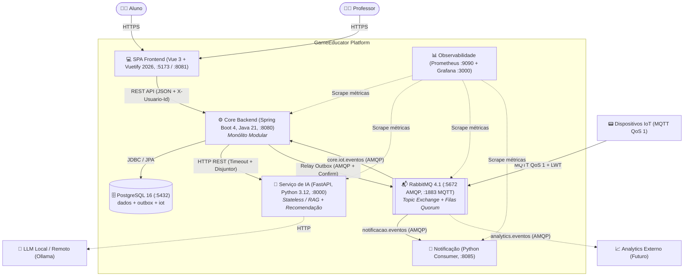
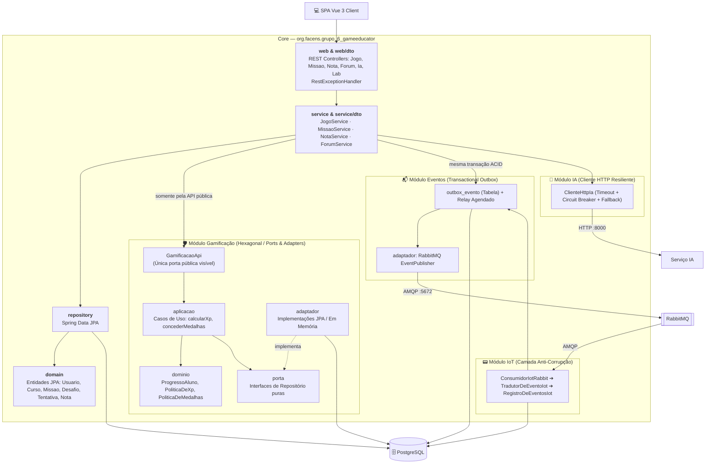
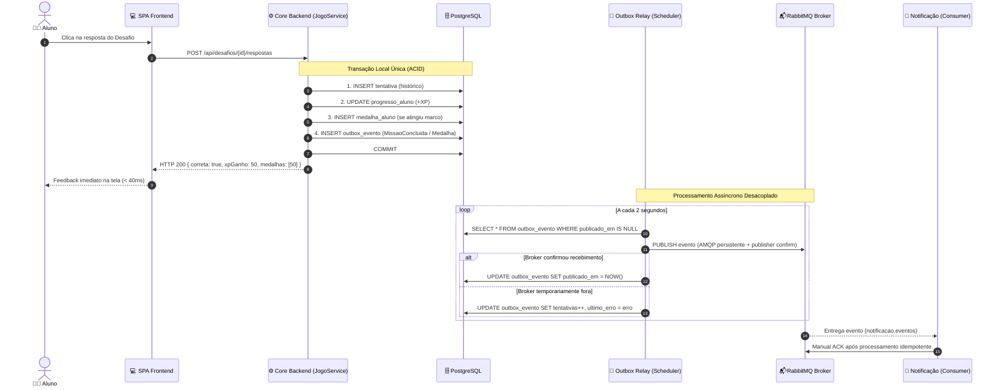
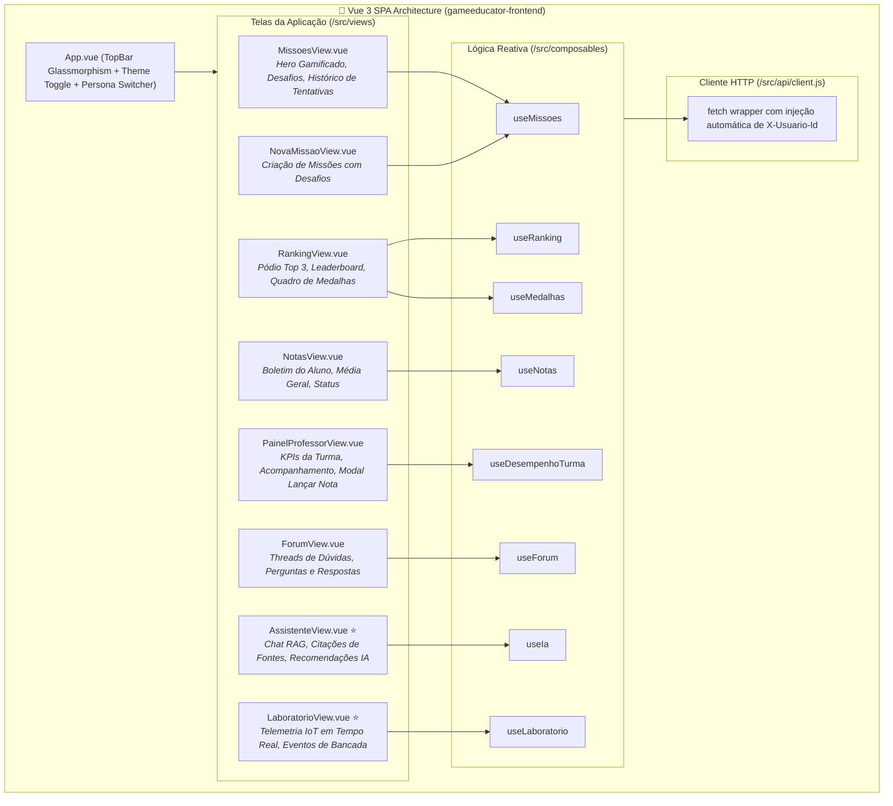
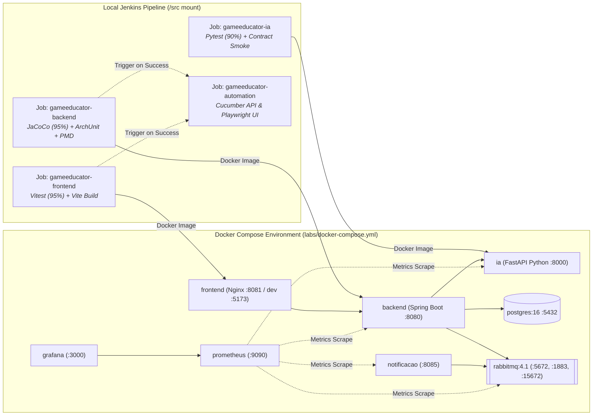

# 🏛️ GameEducator — Architecture Specification & Visual Map

> 💡 **Notion Import Ready**: This document is formatted for direct import into Notion (via *Settings & Members → Import → Markdown* or pasting directly). All diagrams use standard `mermaid` blocks supported natively by Notion's `/mermaid` viewer.

---

### 📋 Page Properties

| Property | Value |
|---|---|
| **System** | GameEducator Platform |
| **Architectural Style** | Polyrepo + Modular Monolith (Core) + Satellite Services (AI, IoT, SPA) |
| **Status** | 🟢 Production / Lab B1 Complete |
| **Last Updated** | November 2026 |
| **Core Repositories** | `gameeducator-backend` · `gameeducator-frontend` · `gameeducator-ia` · `gameeducator-automation` |
| **Test Coverage** | Backend: 95% lines / 90% branches (JaCoCo) · Frontend: 95% lines (Vitest v8) |

---

## 📌 Executive Summary

GameEducator is a gamified learning platform where teachers publish educational content structured into **Missions** and **Challenges** (quizzes/exercises). Students engage with challenges, earn **XP** and unlock **Medals**, compete on class **Rankings**, interact in a peer **Forum**, consult an **AI Assistant (RAG)**, and participate in physical **IoT Laboratories**.

> 🎯 **Core Architectural Philosophy**
> - **Modular Monolith for Core Business Logic**: 1 deployable, 1 database, local ACID transactions for XP/medals/attempts.
> - **Satellite Services for Specialized Loads**: Python FastAPI for AI/ML with independent lifecycle and scaling; RabbitMQ broker with MQTT for unstable edge IoT devices.
> - **Guaranteed Delivery (Transactional Outbox)**: Non-critical side-effects (push notifications, telemetry analytics) are decoupled from HTTP request cycles.

---

## 🗺️ 1. C4 Container Diagram (System Overview)

---

## 🧩 2. Internal Core Architecture (Modular Monolith & Hexagonal)

Inside the single deployable Spring Boot Core (`org.facens.grupo_6_gameeducator`), boundaries are strictly enforced via **ArchUnit** tests:

<b>🔍 Detalhes da Separação Modular (Clique para expandir)</b>

- **Gamificação Isolada (ADR-B1-002)**: As regras de cálculo de XP e medalhas não dependem de Spring Data ou banco de dados. Os casos de uso e o domínio utilizam a porta de repositório, permitindo execução de testes unitários em 3 ms sem inicialização do contexto Spring.
- **ArchUnit Enforcement**: Qualquer injeção indevida ou dependência direta entre camadas é detectada e interrompe o build Maven (`./mvnw test`).

---

## ⚡ 3. Critical Flow: Challenge Response & Transactional Outbox

This sequence illustrates how GameEducator guarantees instant student feedback while maintaining zero data loss across external consumers:

---

## 📱 4. Frontend Architecture (Vue 3 + 2026 Modern Design)

The frontend SPA was recently upgraded with a 2026 modern design system, full coverage of backend capabilities, and 95% line coverage:

---

## 🚀 5. Deployment & CI/CD Topology

---

## 📊 6. Architectural Decision Records (ADRs) Summary

| ADR ID | Decision Summary | Rationale & Trade-offs | Impacted Modules |
|---|---|---|---|
| **ADR-001** | Polyrepo Strategy | Independent build pipelines & toolchains per technology stack (Java, Node, Python). | Workspace structure |
| **ADR-002** | Core Modular Monolith | Single deployable with explicit internal package boundaries rather than microservices network overhead. | `gameeducator-backend` |
| **ADR-B1-001** | High-performance Ranking Index | Compound index `ix_progresso_curso_xp` on PostgreSQL; sub-millisecond leaderboard query. | Database schema |
| **ADR-B1-002** | Hexagonal Architecture for Gamification | Ports & Adapters isolating XP and medal rules from persistence framework. | `gamificacao` module |
| **ADR-B1-003** | Satellite Python AI Service | FastAPI service dedicated to Python-native ML ecosystem with circuit-breaker fallback. | `gameeducator-ia` |
| **ADR-B1-004** | Transactional Outbox + RabbitMQ | Decoupled event publishing with zero message loss and local atomic database commits. | `eventos` module |
| **ADR-B1-005** | IoT Integration via MQTT + ACL | Edge devices communicate over lightweight MQTT 3.1.1 QoS 1; translated via Anti-Corruption Layer. | `iot` module |
| **ADR-B1-006** | Prometheus & Grafana Observability | Comprehensive metrics scraping across Core, AI, Message Broker, and Notification services. | Lab infrastructure |

---

### 📥 How to Import this Page into Notion
1. Open your Notion workspace.
2. Click **Import** in the sidebar and choose **Markdown & CSV**.
3. Select this markdown file (`NOTION_GAMEEDUCATOR_ARCHITECTURE.md`).
4. Notion will automatically convert the headers, property tables, callout blocks, and render all Mermaid diagrams interactively!
