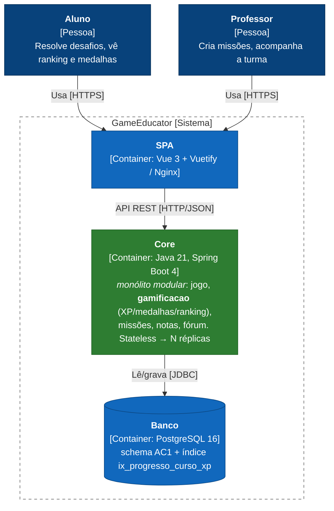
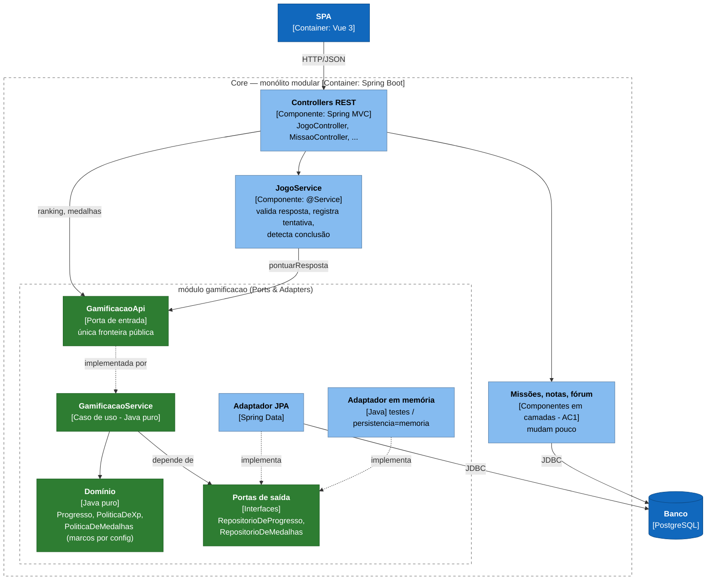
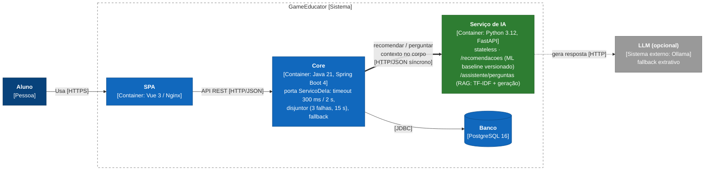
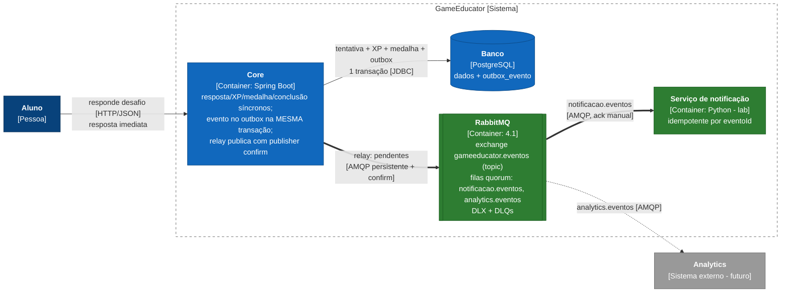
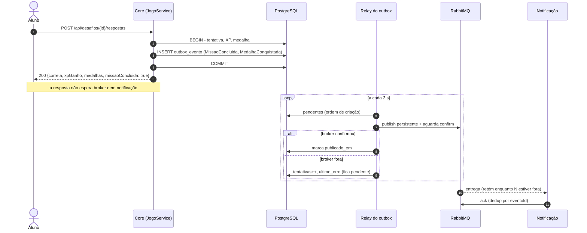
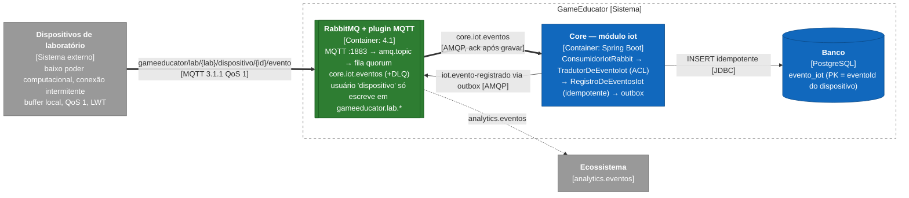
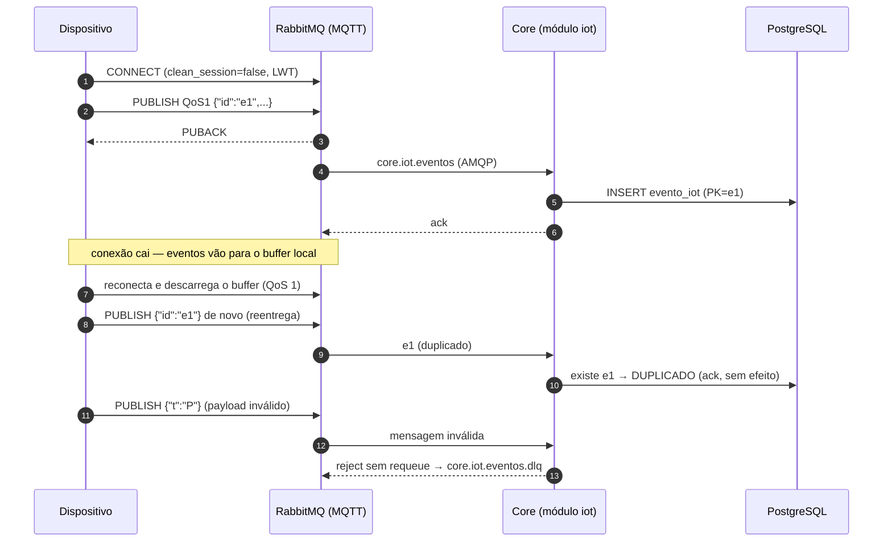
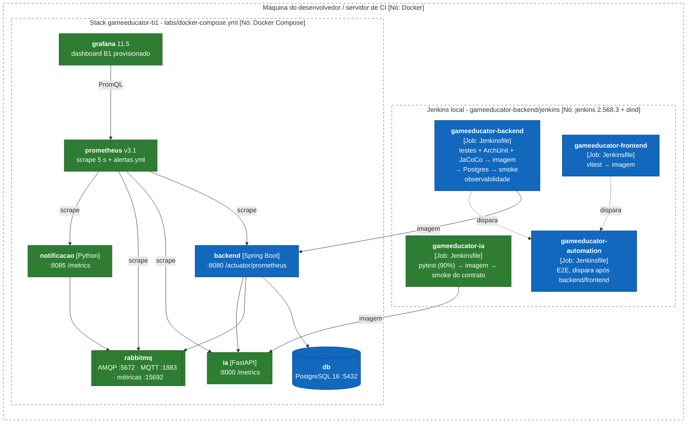
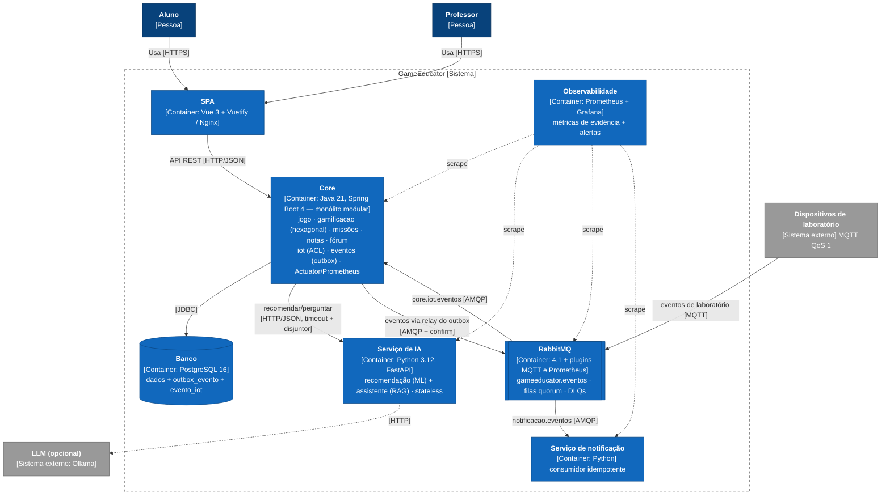

# GameEducator — Registro Arquitetural do B1 (Architecture Lab, 6 desafios)

> Registro **cumulativo e vivo**. Cada desafio segue o mesmo padrão:
> **RF → RNF (FURPS+) → ASR (máx. 3) + RPC → Alternativas/trade-offs → ADR → C4 → Evidência**.
> Regra de ouro: o C4 é explicado pelo ADR; o ADR é sustentado pelos ASRs e RPCs; os ASRs derivam de RF/RNF; a evidência mostra que o raciocínio é plausível.

**Equipe (Grupo 6):** Italo Haas Pascoli (190294) · Maria Eduarda Mota Zandonade (200953)

**Repositórios:** [`gameeducator-backend`](https://github.com/IHPNULL/gameeducator-backend) (Core + este registro + labs) ·
[`gameeducator-frontend`](https://github.com/IHPNULL/gameeducator-frontend) · [`gameeducator-automation`](https://github.com/IHPNULL/gameeducator-automation) ·
`gameeducator-ia` (novo no B1, serviço Python)

| Onde | O quê |
|---|---|
| [`docs/arquitetura/README.md`](README.md) | Este registro: requisitos, matriz de ASRs, RPCs, os 6 desafios, C4 e síntese |
| [`docs/adr/`](../adr/README.md) | ADR-B1-001 … ADR-B1-006 (decisões completas) |
| [`docs/arquitetura/evidencias/`](evidencias/) | Saídas versionadas dos mini-labs (uma pasta por desafio) |
| [`labs/`](../../labs/README.md) | Scripts dos mini-labs, stack Docker do lab, infra (RabbitMQ, Prometheus, Grafana) |

**Convenção dos diagramas C4:** notação C4 (pessoa, container, componente, sistema externo) desenhada com `flowchart`
Mermaid para um layout legível no GitHub. 🟩 verde = elemento novo ou alterado no desafio · 🟦 azul = existente ·
⬜ cinza = sistema externo · borda tracejada = fronteira de sistema/container/módulo.

---

## Índice

1. [Case e mapeamento para o GameEducator](#1-case-e-mapeamento-para-o-gameeducator)
2. [Requisitos funcionais e não funcionais](#2-requisitos)
3. [RPCs — restrições, premissas e constraints](#3-rpcs)
4. [Matriz cumulativa de ASRs](#4-matriz-cumulativa-de-asrs)
5. [Desafio 1 — Drivers e evolução do Core](#desafio-1--drivers-e-evolução-do-core)
6. [Desafio 2 — Organização interna do Core](#desafio-2--organização-interna-do-core)
7. [Desafio 3 — Serviço Python e IA](#desafio-3--serviço-python-e-ia)
8. [Desafio 4 — Comunicação e eventos](#desafio-4--comunicação-e-eventos)
9. [Desafio 5 — IoT e MQTT](#desafio-5--iot-e-mqtt)
10. [Desafio 6 — CI/CD e observabilidade](#desafio-6--cicd-e-observabilidade)
11. [C4 final](#11-c4-final)
12. [Síntese: o que vai para a PoC da AF](#12-síntese-o-que-vai-para-a-poc-da-af)
13. [Como reproduzir as evidências](#13-como-reproduzir-as-evidências)

---

## 1. Case e mapeamento para o GameEducator

O case-base descreve uma plataforma de gamificação para educação continuada que vai evoluir para múltiplas instituições,
recomendação inteligente, assistente com RAG/LLM, notificações, eventos de aprendizagem e IoT. O MVP da AC1 (este produto)
usa outros nomes para os mesmos conceitos:

| Case-base | GameEducator (código) |
|---|---|
| Ranking | `GET /api/cursos/{id}/ranking` (`ProgressoAluno` ordenado por XP) |
| Moedas / pontos | XP (`ProgressoAluno.xpTotal`), creditado no primeiro acerto de cada desafio |
| Badges / conquistas | Medalhas por marco de XP (`Medalha`, marcos 50/100/250/500) |
| Cursos / atividades | Cursos → Missões → Desafios |
| "Concluir curso/atividade" | Concluir a **missão** (acertar todos os desafios), detectado no B1 |

As decisões da AC1 (ADR-001 a ADR-019) continuam válidas, exceto onde um ADR-B1 diz que as substitui.

## 2. Requisitos

### 2.1 Requisitos funcionais (RF)

| RF | Descrição | Desafios | Onde está implementado |
|---|---|---|---|
| RF01 | Ranking da turma por XP | D1, D2, D6 | módulo `gamificacao` (`GamificacaoApi.ranking`) |
| RF02 | Conquistas e regras de gamificação (XP, medalhas, conclusão) | D1, D2, D4 | `gamificacao` + `JogoService.responder` |
| RF03 | Recomendação inteligente de missões | D3 | `gameeducator-ia` (`/recomendacoes`) + `RecomendacaoService` |
| RF04 | Assistente educacional (RAG/LLM) | D3 | `gameeducator-ia` (`/assistente/perguntas`) + `AssistenteService` |
| RF05 | Notificações (medalha, missão concluída) | D4 | eventos via outbox → RabbitMQ → serviço de notificação |
| RF06 | Receber eventos IoT de laboratório e encaminhá-los ao ecossistema | D5 | MQTT → RabbitMQ → módulo `iot` → outbox |

### 2.2 Requisitos não funcionais (RNF) classificados por FURPS+

| RNF | FURPS+ | Analisado em |
|---|---|---|
| Manutenibilidade / modificabilidade / facilidade de evolução | **S**upportability | D1, D2 |
| Testabilidade | **S**upportability | D1, D2, D6 |
| Desempenho / latência / throughput | **P**erformance | D1, D3, D4, D6 |
| Escalabilidade | **P**erformance (capacidade) | D1, D3, D5 |
| Complexidade operacional | **S**upportability / + (operação) | D1, D4, D5 |
| Deploy independente | **S**upportability / + (implantação) | D3, D6 |
| Tolerância a falhas, disponibilidade, recuperabilidade, confiabilidade | **R**eliability | D3, D4, D5, D6 |
| Consistência | **F**unctionality (integridade) | D4 |
| Interoperabilidade | **F**unctionality | D3, D5 |
| Eficiência de comunicação | **P**erformance (recursos) | D5 |
| Segurança de integração | **+** (segurança) | D5 |
| Observabilidade | **S**upportability / + (operação) | D6 |

## 3. RPCs

RPC = requisito, premissa ou constraint que **restringe** a solução. Não é solução.

| RPC | Tipo | Descrição | Desafios |
|---|---|---|---|
| RPC-01 | Tecnologia / legado | Core em Java 21 + Spring Boot (AC1) e continua assim | D1–D6 |
| RPC-02 | Equipe | 6 desenvolvedores | D1, D4 |
| RPC-03 | Dados / legado | Banco relacional (PostgreSQL; H2 em dev/testes); schema da AC1 sem ferramenta de migração | D1, D2 |
| RPC-04 | Legado | Regras existentes reaproveitadas; proibido reescrever o produto para aplicar um padrão | D2 |
| RPC-05 | Tecnologia | ML e RAG desenvolvidos em Python | D3 |
| RPC-06 | Negócio | Indisponibilidade da IA não bloqueia o fluxo essencial | D3 |
| RPC-07 | Negócio | Operações essenciais concluem mesmo com consumidor externo indisponível | D4 |
| RPC-08 | Operação | Adotar broker tem custo operacional | D4, D5 |
| RPC-09 | Dispositivo / rede | Dispositivos com baixo poder computacional e conectividade intermitente | D5 |
| RPC-10 | Operação / protocolo | Protocolo e broker adicionam componentes operacionais | D5 |
| RPC-11 | Ferramentas | Jenkins é a base da esteira; Prometheus/Grafana no lab; artefatos e configurações versionados | D6 |
| RPC-12 | Premissa (AC1) | Polyrepo (ADR-001); identidade por header `X-Usuario-Id` sem autenticação real (ADR-005) | todos |

## 4. Matriz cumulativa de ASRs

Um ASR é um RNF capaz de alterar **estrutura, comunicação, dados, implantação ou operação**. Nem todo RNF entra aqui.

| ASR | Qualidade (FURPS+) | Cenário de qualidade (estímulo → resposta → medida) | Dimensão alterada | Desafio | Decisão | Evidência | Status |
|---|---|---|---|---|---|---|---|
| ASR-01 | Modificabilidade (S) | Mudar uma regra de gamificação → altera só o módulo → 0 classes de fora conhecem internos | Estrutura | D1 | [ADR-B1-001](../adr/ADR-B1-001-monolito-modular.md) | jdeps + ArchUnit | ✅ medido |
| ASR-02 | Desempenho/escala do ranking (P) | 100 mil usuários, curso com 20 mil alunos → ranking top-50 → < 50 ms no banco | Dados, implantação | D1, D6 | ADR-B1-001 | benchmark PostgreSQL | ✅ medido |
| ASR-03 | Complexidade operacional (S/+) | Equipe de 6 → nº de deployáveis do Core → 1 | Implantação, operação | D1 | ADR-B1-001 | C4 Container | ✅ |
| ASR-04 | Modificabilidade das regras (S) | Mudar marcos de medalha → só configuração → 0 linhas de código | Estrutura | D2 | [ADR-B1-002](../adr/ADR-B1-002-hexagonal-na-gamificacao.md) | `TrocaDeAdaptadorNoContextoTest` | ✅ medido |
| ASR-05 | Testabilidade do domínio (S) | Testar regra de XP/medalha → sem Spring/banco → ms | Estrutura | D2 | ADR-B1-002 | contrato JPA × memória | ✅ medido |
| ASR-06 | Tolerância a falhas do fluxo essencial (R) | IA fora/lenta → Core responde com fallback/503 → p95 limitada pelo timeout, 0 erro no fluxo essencial | Comunicação | D3, D6 | [ADR-B1-003](../adr/ADR-B1-003-servico-python-de-ia.md) | lab D3 + Prometheus | ⏳ lab pendente |
| ASR-07 | Deploy independente (S) | Novo modelo → deploy só da IA → 0 deploy do Core | Implantação | D3, D6 | ADR-B1-003, ADR-B1-006 | repo + pipeline próprios | ✅ |
| ASR-08 | Escala da carga variável de IA (P) | Pico no assistente → escala só a IA → Core não disputa recursos | Implantação | D3 | ADR-B1-003 | C4 Container (container próprio) | ✅ estrutural |
| ASR-09 | Tolerância a falha de consumidor externo (R) | Notificação fora → conclusão da missão → 100% concluídas | Comunicação | D4 | [ADR-B1-004](../adr/ADR-B1-004-eventos-outbox-rabbitmq.md) | lab D4 síncrono × assíncrono | ⏳ lab pendente |
| ASR-10 | Recuperabilidade (R) | Broker/consumidor fora → eventos retidos → 0 perdidos após voltar | Dados, operação | D4, D6 | ADR-B1-004 | lab D4 (outbox/fila drenam) | ⏳ lab pendente |
| ASR-11 | Consistência do resultado (F) | Resposta que conclui missão → XP/medalha/conclusão atômicos; notificação eventual | Dados | D4 | ADR-B1-004 | `AlunoConcluiMissaoTest` | ✅ |
| ASR-12 | Tolerância à conectividade intermitente (R) | Queda no meio do lote + reentregas → 0 perdidos, 0 duplicados no Core | Comunicação, dados | D5 | [ADR-B1-005](../adr/ADR-B1-005-iot-mqtt.md) | lab D5 | ⏳ lab pendente |
| ASR-13 | Eficiência de comunicação (P) | Evento de presença → bytes por evento → MQTT ≪ REST | Comunicação | D5 | ADR-B1-005 | simulador (bytes/evento) | ⏳ lab pendente |
| ASR-14 | Segurança/isolamento da integração (+) | Dispositivo malicioso/bugado → não alcança o Core nem eventos internos → DLQ / acesso negado | Estrutura, operação | D5 | ADR-B1-005 | permissões por tópico + DLQ | ⏳ lab pendente |
| ASR-15 | Observabilidade orientada a decisão (S/+) | Condição provocada → métrica do ASR muda → visível em ≤ 15 s | Operação | D6 | [ADR-B1-006](../adr/ADR-B1-006-cicd-e-observabilidade.md) | Prometheus/Grafana | ⏳ lab pendente |
| ASR-16 | Deploy independente e seguro (S) | Commit quebra fronteira/contrato → pipeline bloqueia → 0 deploy quebrado | Implantação | D6 | ADR-B1-006 | Jenkinsfiles + ArchUnit | ⏳ lab pendente |
| ASR-17 | Recuperabilidade operacional (R) | IA/broker/consumidor degradado → alerta → `for` ≤ 1 min | Operação | D6 | ADR-B1-006 | `alertas.yml` | ⏳ lab pendente |

RNFs analisados e **não** promovidos a ASR (por quê): interoperabilidade em D3/D5 (HTTP/JSON e MQTT, padrões de mercado, já resolvem); latência em D4 (tirar a notificação do caminho só ajuda); escalabilidade em D5 (dezenas de laboratórios); manutenibilidade em D3 (consequência do ASR-07).

---

## Desafio 1 — Drivers e evolução do Core

**Pergunta:** o crescimento de 1 mil para 100 mil usuários, com o ranking crescendo mais, exige separar serviços?

**1. RF:** RF01 Ranking; RF02 Conquistas; evolução das funcionalidades existentes.
**2. RNF:** manutenibilidade, desempenho, escalabilidade, testabilidade, complexidade operacional.

**3. ASRs (máx. 3)**
- **ASR-01 Manutenibilidade/modificabilidade:** altera a **estrutura**. Conquistas e cursos continuam evoluindo e o código precisa de fronteiras por capacidade, não só por camada técnica.
- **ASR-02 Desempenho/escalabilidade do ranking:** altera **dados** (índice, top-N) e **implantação** (réplicas). É o único ASR que poderia justificar um serviço separado, por isso foi medido.
- **ASR-03 Complexidade operacional:** altera **implantação/operação**. Com 6 devs, cada deployável a mais é pipeline, monitoramento e plantão a mais.
- *Testabilidade* não entrou aqui: é tratada no D2, onde de fato muda a estrutura interna.

**4. RPCs:** RPC-01 (Java/Spring), RPC-02 (6 devs), RPC-03 (banco relacional + legado AC1).

**5. Decisão do Tech Lead**
- *RNFs que viram ASR:* manutenibilidade, desempenho/escala do ranking e complexidade operacional.
- *Há necessidade **comprovada** de escala/deploy independente?* **Não.** O benchmark com 100 mil usuários mostrou que o problema do ranking é de **consulta**, e se resolve com índice e top-N dentro do monólito. Ninguém precisa publicar o ranking em ritmo diferente do resto.
- *A complexidade distribuída é justificável?* **Ainda não.** Rede, consistência entre bancos e mais um pipeline sem um ASR que os exija. O gatilho de revisão está no ADR.

**6. Alternativas e trade-offs**

| | (A) Monólito em camadas | **(B) Monólito modular** | (C) Serviço de ranking |
|---|---|---|---|
| ASR-01 modificabilidade | ✗ mudança de regra atravessa camadas (4 classes de fora conheciam internos) | ✓ API pública + fronteira verificada | ✓ |
| ASR-02 ranking | ✓ (com índice) | ✓ índice + réplicas stateless | ✓ escala só o ranking |
| ASR-03 custo operacional | 1 deployável | **1 deployável** | 2+ deployáveis, consistência eventual do XP |
| Trade-off principal | simples, mas apodrece | disciplina de módulos (ArchUnit) | paga complexidade sem evidência |

**7. Evidência (mini-lab).** *Hipótese:* reorganizar a gamificação em módulo reduz o acoplamento sem mudar o comportamento, e o ranking não exige serviço próprio.

| Medida | Antes (AC1) | Depois (módulo) | Fonte |
|---|---|---|---|
| Classes **fora** da gamificação que conhecem entidades/repositórios/regras dela | **4** (`JogoService`, `JogoController`, `MedalhaResponse`, `RankingItemResponse`) | **0** | [jdeps](evidencias/desafio-1/dependencias-antes-depois.md) |
| Dependências de fora para internos da gamificação | **8** | **0** | idem |
| Fan-out do `JogoService` (classes do Core) | 20 | 19 (troca 4 internos por 3 tipos da API) | idem |
| Violação proposital de fronteira (`web` → entidade JPA da gamificação) | — | **build falha** (`ArquiteturaModularTest`) | [fitness-function.txt](evidencias/desafio-1/fitness-function.txt) |
| Ranking top-50, curso de 20 mil alunos, 100 mil usuários (PostgreSQL 16) | 7,4 ms sem índice | **0,22 ms** com `ix_progresso_curso_xp` | [benchmark](evidencias/desafio-1/benchmark-ranking.md) |
| Ranking completo (API atual) no mesmo curso | 20,2 ms | 12,8 ms | idem |
| Testes do Core | 91 (AC1) | 161 verdes ao fim do B1; cobertura 99,8% linhas / 97,4% branches | `mvn verify` |

*Leitura honesta:* o fan-out do `JogoService` quase não mudou (20 → 19). O ganho está em **quem conhece os internos**: 4 → 0. Ou seja, mudar a regra ou a persistência de XP e medalhas deixou de ter efeito colateral fora do módulo. O ranking completo (12,8 ms) mostra que o risco real é **o tamanho da resposta**, não o processo, e por isso a paginação/top-N foi registrada como pendência para a AF.

**8. ADR + C4:** [ADR-B1-001](../adr/ADR-B1-001-monolito-modular.md). A decisão é interna ao Core: o C4 Container continua com **um** container de Core, agora com módulos explícitos, e o C4 Component vem no D2.



**Rastreabilidade:** RF01/RF02 → manutenibilidade, desempenho, complexidade operacional → ASR-01/02/03 + RPC-01/02/03 → A×B×C → ADR-B1-001 → C4 Container (1 Core modular) → jdeps 4→0, ArchUnit, benchmark 0,22 ms.

---

## Desafio 2 — Organização interna do Core

**Pergunta:** como proteger as regras de gamificação, que mudam com frequência, de banco, framework e integrações?

**1. RF:** RF01 Ranking; RF02 Conquistas e regras de gamificação.
**2. RNF:** manutenibilidade, testabilidade, modificabilidade, facilidade de evolução.

**3. ASRs (2 escolhidos)**
- **ASR-04 Modificabilidade das regras:** altera a **estrutura**. A regra precisa morar em código sem dependências técnicas, com os marcos de medalha como parâmetro.
- **ASR-05 Testabilidade do domínio:** altera a **estrutura**, invertendo a dependência da persistência. O domínio define portas e a infraestrutura as implementa.
- Manutenibilidade e facilidade de evolução são consequência desses dois e não acrescentam decisão.

**4. RPCs:** RPC-01 (continua Spring Boot), RPC-04 (reaproveitar regras; proibido reescrever o produto).

**5. Decisão do Tech Lead**
- *Qual dependência precisa ser invertida?* Só **regra de gamificação → JPA/Spring Data**. `web → service` continua igual.
- *O custo é proporcional?* Sim, porque está limitado a um módulo. Fórum, notas e missões mudam pouco e ficam em camadas.
- *DDD, Hexagonal, Clean e Onion concorrem?* **Não.** Hexagonal, Clean e Onion são a mesma regra de dependência (tudo aponta para o domínio) com nomes diferentes; usamos o vocabulário de Ports & Adapters. Do DDD entra só a parte **tática** que paga o custo: objeto de valor `Progresso`, políticas `PoliticaDeXp`/`PoliticaDeMedalhas` e linguagem ubíqua.

**6. Alternativas e trade-offs**

| | Camadas atuais | Regras puras sem portas | **Ports & Adapters no módulo** | Clean em todo o Core |
|---|---|---|---|---|
| ASR-04 | marcos fixos no service | ✓ regras | ✓ regras + marcos por config | ✓ |
| ASR-05 | Spring + H2 para testar | parcial (caso de uso preso ao JPA) | ✓ domínio e caso de uso sem Spring; mesmo contrato contra 2 adaptadores | ✓ |
| Custo | 0 | baixo | **médio, localizado** | alto (viola RPC-04) |

**7. Evidência (mini-lab).** *Hipótese:* com a dependência invertida, a mesma regra roda com adaptadores diferentes sem mudar uma linha do domínio. Detalhes em [troca-de-adaptador.md](evidencias/desafio-2/troca-de-adaptador.md).

| Teste | Adaptador | Spring? | Resultado |
|---|---|---|---|
| `RegrasDeGamificacaoTest` (XP só no 1º acerto, marcos cruzados, marcos configuráveis) | nenhum | não | 5/5 em 3 ms |
| `GamificacaoServiceTest` (caso de uso completo) | **memória** | não | 3/3 em 2 ms |
| `ContratoRepositoriosDeGamificacao` → `RepositoriosEmMemoriaTest` | **memória** | não | 4/4 |
| **Mesmo contrato** → `RepositoriosJpaTest` | **JPA + H2** | sim | 4/4 |
| `TrocaDeAdaptadorNoContextoTest` (`app.gamificacao.persistencia=memoria`, `marcos-xp=10,20`) | memória | sim | app sobe e aplica os marcos da config |
| `AlunoGanhaMedalhaTest` (cenários BDD da AC1, sem alteração de regra) | JPA | sim | 4/4 |
| `ArquiteturaModularTest`: domínio só depende de `java.*`; aplicação não conhece adaptador/Spring/JPA | — | não | regras verdes |

**8. ADR + C4:** [ADR-B1-002](../adr/ADR-B1-002-hexagonal-na-gamificacao.md).



**Rastreabilidade:** RF01/RF02 → modificabilidade, testabilidade → ASR-04/05 + RPC-01/04 → camadas × regras puras × hexagonal local × Clean global → ADR-B1-002 → C4 Component → mesmo contrato verde em JPA e em memória; domínio testado sem Spring.

---

## Desafio 3 — Serviço Python e IA

**Pergunta:** onde fica a fronteira de ML e RAG/LLM, e o que acontece quando a IA cai?

**1. RF:** RF03 Recomendação inteligente; RF04 Assistente educacional.
**2. RNF:** deploy independente, escalabilidade, tolerância a falhas, interoperabilidade, desempenho, manutenibilidade.

**3. ASRs (máx. 3)**
- **ASR-06 Tolerância a falhas do fluxo essencial:** altera a **comunicação**. Timeout, disjuntor e fallback; a IA nunca fica no caminho de escrita essencial.
- **ASR-07 Deploy independente:** altera a **implantação**. O modelo muda em outro ritmo, com outra stack, outra imagem e outro pipeline.
- **ASR-08 Escalabilidade da carga variável:** altera a **implantação/operação**. Picos do assistente não podem disputar recursos com o Core.

**4. RPCs:** RPC-01 (Core Java), RPC-05 (ML/RAG em Python), RPC-06 (IA fora não bloqueia o essencial).

**5. Decisão do Tech Lead**
- *Python por si só justifica um serviço?* **Não.** Daria para embutir (GraalPy, processo filho). O que justifica a rede são os ASR-07 e ASR-08 somados à RPC-06.
- *ML e RAG precisam da mesma fronteira?* Hoje ficam **juntos no mesmo deployável, em módulos separados**: mesma equipe, mesma stack, ambos stateless, volume baixo. **Gatilho de separação:** o RAG passar a usar LLM com GPU/custo por token ou ter p95 e escala muito diferentes do ML.
- *Quais ASRs justificam autonomia e escala?* ASR-07 e ASR-08. O ASR-06 define **como** o Core se protege.
- *Comportamento degradado aceitável:* recomendação → **200 com `origem: "fallback"`** (próximas missões não concluídas); assistente → **503 com mensagem clara**. Nada do fluxo essencial é afetado.

**6. Alternativas e trade-offs**

| | (A) IA embutida no Core | (B) Módulo acoplado (mesmo processo/imagem) | **(C) Serviço Python independente** |
|---|---|---|---|
| ASR-06 | falha/latência do modelo derruba o Core | parcial | ✓ timeout 2 s + disjuntor + fallback |
| ASR-07 | modelo novo = deploy do Core | parcial | ✓ repo, imagem e pipeline próprios |
| ASR-08 | escala junto | não | ✓ réplicas próprias |
| Custo | acoplamento | médio | rede + contrato + 1 container |

Comunicação **síncrona HTTP/JSON**, e não fila: recomendação e resposta são consultas que o aluno espera na tela. A resiliência vem do timeout e do fallback, não de buffer.

**7. Evidência (mini-lab).** *Hipótese:* com a IA fora ou lenta, o Core continua respondendo dentro do limite do timeout, e o disjuntor transforma falhas repetidas em respostas imediatas. Script: [`labs/desafio-3/executar.sh`](../../labs/desafio-3/executar.sh).

> ⏳ **Execução pendente.** O mini-lab está implementado e versionado; o resultado será gravado em [`evidencias/desafio-3/resultado.md`](evidencias/desafio-3/) ao rodar `labs/desafio-3/executar.sh` com a stack do lab no ar. Cobertura automatizada já existente: ver testes citados no ADR.

**8. ADR + C4:** [ADR-B1-003](../adr/ADR-B1-003-servico-python-de-ia.md).



**Rastreabilidade:** RF03/RF04 → tolerância a falhas, deploy independente, escala → ASR-06/07/08 + RPC-01/05/06 → A×B×C (+ ML/RAG juntos) → ADR-B1-003 → C4 Container com a fronteira da IA → lab D3.

---

## Desafio 4 — Comunicação e eventos

**Pergunta:** onde o síncrono é necessário e onde eventos reduzem acoplamento? Uma falha de notificação não pode impedir a conclusão.

**1. RF:** RF02 Conquistas; RF05 Notificações; eventos de conclusão de atividade (missão).
**2. RNF:** tolerância a falhas, disponibilidade, latência, consistência, desacoplamento, recuperabilidade.

**3. ASRs (máx. 3)**
- **ASR-09 Tolerância a falha de consumidor externo:** altera a **comunicação**. Notificação e analytics saem do caminho síncrono.
- **ASR-10 Recuperabilidade:** altera **dados e operação**. O evento precisa ser durável antes da entrega (outbox, fila durável, DLQ).
- **ASR-11 Consistência do resultado:** altera **dados**. XP, medalha e conclusão são atômicos e imediatos; a notificação é eventual.

**4. RPCs:** RPC-07 (essencial conclui com consumidor fora), RPC-08 (broker tem custo), RPC-02 (6 devs).

**5. Decisão do Tech Lead**

| O quê | Quando | Como |
|---|---|---|
| Tentativa, XP, medalha, detecção de conclusão | **Imediato**, atômico | Transação local (síncrono) |
| Notificação ao aluno | **Eventual** (segundos) | Evento → RabbitMQ → serviço de notificação |
| Analytics | **Eventual** | Mesmo evento, fila própria (*fan-out*) |

- *Que ASR justifica mensageria?* O ASR-09 **somado** ao ASR-10. `@Async` resolveria o ASR-09, mas perde evento em restart; outbox + retry HTTP resolveria o ASR-10, mas sem *fan-out* e com cada consumidor mudando o Core.
- *RabbitMQ/Kafka resolvem um problema real?* **RabbitMQ sim:** filas duráveis por consumidor, ack/nack + DLQ, roteamento por tipo, e o mesmo broker atende MQTT no D5. **Kafka ainda não:** replay e alto throughput não são requisitos hoje (dezenas de eventos/s); gatilho registrado no ADR.

**6. Alternativas e trade-offs**

| | REST síncrono | `@Async` em memória | Publicar direto no broker | **Outbox + RabbitMQ** | Outbox + Kafka |
|---|---|---|---|---|---|
| ASR-09 | ✗ falha derruba a conclusão | ✓ | ✓ | ✓ | ✓ |
| ASR-10 | ✗ | ✗ perde em restart | ✗ *dual write* | ✓ | ✓ (+ replay) |
| ASR-11 | ✓ | ✓ | ✗ | ✓ | ✓ |
| Custo | 0 | 0 | médio | médio | alto |

**7. Evidência (mini-lab).** *Hipótese:* com o consumidor de notificação fora, o modo síncrono derruba a conclusão e o assíncrono não. Com o **broker** fora, nada se perde: o outbox acumula e drena. Script: [`labs/desafio-4/executar.sh`](../../labs/desafio-4/executar.sh).

> ⏳ **Execução pendente.** O mini-lab está implementado e versionado; o resultado será gravado em [`evidencias/desafio-4/resultado.md`](evidencias/desafio-4/) ao rodar `labs/desafio-4/executar.sh` com a stack do lab no ar. Cobertura automatizada já existente: ver testes citados no ADR.

**8. ADR + C4:** [ADR-B1-004](../adr/ADR-B1-004-eventos-outbox-rabbitmq.md).





**Rastreabilidade:** RF02/RF05 → tolerância a falhas, recuperabilidade, consistência → ASR-09/10/11 + RPC-07/08 → REST × @Async × dual write × outbox+RabbitMQ × outbox+Kafka → ADR-B1-004 → C4 + sequência → lab D4.

---

## Desafio 5 — IoT e MQTT

**Pergunta:** como trazer eventos de dispositivos limitados e instáveis sem acoplar o Core a cada dispositivo?

**1. RF:** RF06 Receber eventos IoT e encaminhá-los ao ecossistema.
**2. RNF:** interoperabilidade, eficiência de comunicação, disponibilidade, tolerância à conectividade intermitente, escalabilidade, segurança de integração.

**3. ASRs (máx. 3)**
- **ASR-12 Tolerância à conectividade intermitente:** altera a **comunicação** (QoS 1, sessão persistente, buffer no dispositivo) e os **dados** (idempotência por `eventoId`).
- **ASR-13 Eficiência de comunicação:** altera o **protocolo**: conexão persistente e payload compacto, em vez de HTTP por evento.
- **ASR-14 Segurança/isolamento da integração:** altera a **estrutura e a operação**. O dispositivo nunca fala com o Core; credencial e permissão por tópico no broker; camada anticorrupção valida o payload.

**4. RPCs:** RPC-09 (dispositivo limitado, rede intermitente), RPC-10 (protocolo/broker = componentes), RPC-08 (custo de broker), broker do D4 já em operação.

**5. Decisão do Tech Lead**
- *REST é suficiente?* Para dispositivos sempre conectados, sim. Aqui não: cada evento pagaria TCP/TLS + cabeçalhos HTTP, e reenvio e buffer ficariam por conta do firmware.
- *O que o MQTT resolve especificamente?* Conexão leve e persistente, **QoS 1 com PUBACK**, sessão persistente, **LWT** (aviso de queda) e tópicos hierárquicos que roteiam por laboratório sem o Core saber disso.
- *Depois do MQTT, outro broker?* **Não.** O plugin MQTT do RabbitMQ (D4) publica no `amq.topic`, que é roteado para a fila AMQP `core.iot.eventos`: **zero componentes novos**. Gatilho para broker MQTT dedicado: milhares de conexões simultâneas.
- *Duplicidade/perda?* Perda: QoS 1 + buffer local + fila quorum + ack só depois de gravar. Duplicidade: `eventoId` gerado no dispositivo = **PK** no Core. Lixo: DLQ.

**6. Alternativas e trade-offs**

| | (A) REST direto | (B) MQTT (Mosquitto) + gateway | (C) MQTT + bridge p/ mensageria interna | **(B') MQTT no RabbitMQ + consumidor ACL** |
|---|---|---|---|---|
| ASR-12 | retry/buffer no device; Core exposto | ✓ | ✓ | ✓ |
| ASR-13 | ✗ HTTP por evento | ✓ | ✓ | ✓ |
| ASR-14 | ✗ Core vira gateway | ✓ | ✓ | ✓ permissões por tópico + ACL + DLQ |
| Componentes novos | 0 | 2 | 2 (dois brokers) | **0** |

**7. Evidência (mini-lab).** *Hipótese:* com queda de conexão no meio do lote, reentregas duplicadas e um payload inválido, o Core registra cada evento único **exatamente uma vez** e isola o inválido. Script: [`labs/desafio-5/executar.sh`](../../labs/desafio-5/executar.sh).

> ⏳ **Execução pendente.** O mini-lab está implementado e versionado; o resultado será gravado em [`evidencias/desafio-5/resultado.md`](evidencias/desafio-5/) ao rodar `labs/desafio-5/executar.sh` com a stack do lab no ar. Cobertura automatizada já existente: ver testes citados no ADR.

**8. ADR + C4:** [ADR-B1-005](../adr/ADR-B1-005-iot-mqtt.md).





**Rastreabilidade:** RF06 → conectividade intermitente, eficiência, segurança → ASR-12/13/14 + RPC-08/09/10 → A×B×C×B' → ADR-B1-005 → C4 Container + fluxo → lab D5.

---

## Desafio 6 — CI/CD e observabilidade

**Pergunta:** a arquitetura resultante pode ser construída, implantada e observada com segurança?

**1. RF:** todos os RFs impactados pelos componentes construídos (RF01–RF06); operação e evolução.
**2. RNF:** observabilidade, deploy independente, confiabilidade, testabilidade, recuperabilidade, desempenho.

**3. ASRs (máx. 3)**
- **ASR-15 Observabilidade orientada a decisão:** altera a **operação**. Cada ASR anterior ganha uma métrica que diz se a decisão funciona em execução.
- **ASR-16 Deploy independente e seguro:** altera a **implantação**. Um pipeline por componente, com *gates* que bloqueiam deploy, incluindo regras de arquitetura.
- **ASR-17 Recuperabilidade operacional:** altera a **operação**. Degradações viram alertas versionados.

**4. RPCs:** RPC-11 (Jenkins; Prometheus/Grafana; tudo versionado).

**5. Decisão do Tech Lead**
- *Serviços independentes exigem pipelines independentes?* **Sim**: Core, IA e frontend têm `Jenkinsfile` próprio. O E2E (`gameeducator-automation`) continua encadeado após backend/frontend, para proteger a integração.
- *O que bloqueia deploy?* Core: testes + **ArchUnit** (fronteiras D1–D5) + JaCoCo 95/90 + integração Postgres + **smoke de observabilidade** (métricas de evidência expostas). IA: pytest (gate 90%) + imagem + **smoke do contrato** `/recomendacoes`.
- *Quais métricas validam ASRs anteriores?* Ver a tabela "ASR → métrica" no [ADR-B1-006](../adr/ADR-B1-006-cicd-e-observabilidade.md).
- *Métrica técnica × evidência arquitetural:* CPU/heap dizem se o processo está saudável. **Evidência arquitetural** é uma métrica ligada a um ASR, coletada sob uma condição **provocada** e comparada com o que o ADR prevê.

**6. Alternativas e trade-offs**

| | Pipeline único | **Pipeline por componente + E2E encadeado** |
|---|---|---|
| ASR-16 | deploy acoplado (IA espera o Core) | ✓ cada componente publica sozinho |
| Integração | testada sempre | testada pelo E2E encadeado |
| Custo | 1 arquivo | N arquivos com o mesmo padrão |

Métricas escolhidas (e não "tudo"): latência p95 e erros 5xx por rota (desempenho/confiabilidade), `up` (disponibilidade), throughput, `gameeducator_ia_*` (D3), `gameeducator_outbox_pendentes` + `rabbitmq_queue_messages_ready` (D4) e `gameeducator_iot_eventos_total` (D5).

**7. Evidência (mini-lab).** *Hipótese:* cada condição de degradação provocada aparece na métrica do ASR correspondente e dispara o alerta. Script: [`labs/desafio-6/executar.sh`](../../labs/desafio-6/executar.sh).

> ⏳ **Execução pendente.** O mini-lab está implementado e versionado; o resultado será gravado em [`evidencias/desafio-6/resultado.md`](evidencias/desafio-6/) ao rodar `labs/desafio-6/executar.sh` com a stack do lab no ar. Cobertura automatizada já existente: ver testes citados no ADR.

**8. ADR + C4:** [ADR-B1-006](../adr/ADR-B1-006-cicd-e-observabilidade.md).



**Rastreabilidade:** RF01–RF06 + operação → observabilidade, deploy independente, recuperabilidade → ASR-15/16/17 + RPC-11 → pipeline único × por componente → ADR-B1-006 → C4 Deployment → pipelines + condições provocadas no Prometheus/Grafana.

---

## 11. C4 final



| Componente | Repositório | Pipeline | Decisões |
|---|---|---|---|
| Core | `gameeducator-backend` | `Jenkinsfile` (backend) | ADR-B1-001…006 |
| Serviço de IA | `gameeducator-ia` | `Jenkinsfile` (ia) | ADR-B1-003, 006 |
| SPA | `gameeducator-frontend` | `Jenkinsfile` (frontend) | AC1 (ADR-013/014) |
| E2E | `gameeducator-automation` | `Jenkinsfile` (automation, encadeado) | AC1 (ADR-015) |
| RabbitMQ, notificação, Prometheus, Grafana (lab) | `gameeducator-backend/labs` | — (infra como código) | ADR-B1-004…006 |

## 12. Síntese: o que vai para a PoC da AF

| Levar para a PoC | Por quê (ASR) | Próximo passo na AF |
|---|---|---|
| Monólito modular com fronteiras verificadas (ArchUnit) | ASR-01/03: mudança localizada com 1 deployável | Extrair o próximo módulo (missões) com o mesmo padrão; **paginar/top-N o ranking** |
| Hexagonal **só** onde a regra muda (gamificação) | ASR-04/05 | Regras de recompensa por instituição (multi-tenant) como nova política |
| Serviço de IA independente + timeout/disjuntor/fallback | ASR-06/07/08 | Modelo de recomendação treinado com o histórico; separar RAG se o LLM exigir GPU |
| Outbox + RabbitMQ para o que é eventual | ASR-09/10/11 | `SKIP LOCKED` no relay para várias réplicas; consumidor real de notificação (e-mail/push) |
| MQTT no mesmo broker + ACL idempotente | ASR-12/13/14 | TLS na porta 8883 e credencial por dispositivo |
| Pipeline por componente + métricas de evidência + alertas | ASR-15/16/17 | Tracing distribuído (OpenTelemetry) e SLOs com *error budget* |
| **Não** levar: serviço de ranking separado, Kafka, segundo broker MQTT | sem ASR que justifique hoje | Gatilhos de revisão documentados em cada ADR |

**Riscos conhecidos:** identidade por header sem autenticação (ADR-005 da AC1), que continua sendo bloqueador para produção; schema por `ddl-auto` sem migrações (ADR-009 da AC1), cuja revisão (Flyway) é recomendada antes da AF; relay do outbox com uma réplica.

## 13. Como reproduzir as evidências

Pré-requisitos: JDK 21, Docker, Python 3.12, e os repositórios lado a lado (`gameeducator-backend`, `gameeducator-ia`, …).

```bash
# D1/D2 (sem Docker, exceto o benchmark)
cd gameeducator-backend
./mvnw clean verify                              # 161 testes + ArchUnit + gate JaCoCo
labs/desafio-1/provar-fitness-function.sh        # violação proposital quebra o build
labs/desafio-1/benchmark-ranking.sh              # PostgreSQL 16 em container, 100k usuários
labs/desafio-2/relatorio-adaptadores.sh          # mesmo contrato: JPA x memória
# jdeps antes/depois: ver o cabeçalho de labs/desafio-1/analisar_dependencias.py

# D3–D6 (stack completa)
docker compose -f labs/docker-compose.yml up -d --build
labs/desafio-3/executar.sh
labs/desafio-4/executar.sh
labs/desafio-5/executar.sh
labs/desafio-6/executar.sh
# Grafana: http://localhost:3000 (dashboard "GameEducator B1 - Evidencias arquiteturais")
docker compose -f labs/docker-compose.yml down -v
```
