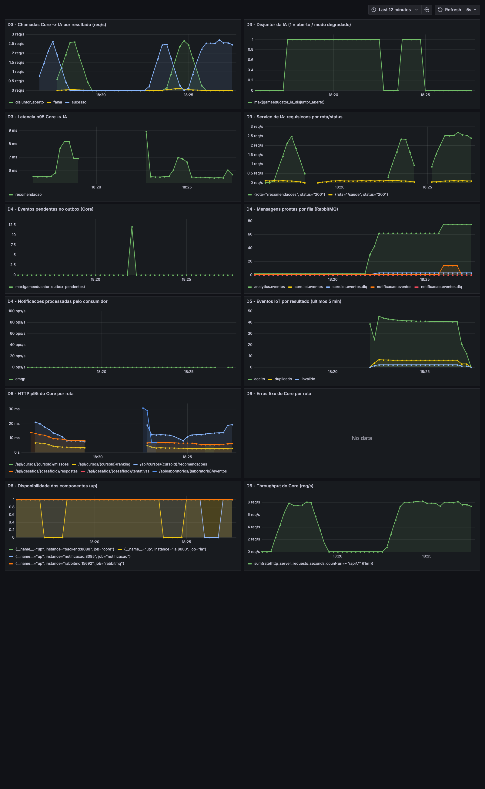

# Desafio 6 - condicoes provocadas e efeito nas metricas (Prometheus)

Gerado por `labs/desafio-6/executar.sh` em 2026-10-14 18:27. Trafego sintetico: ranking, recomendacoes e respostas a cada 0,3 s.
Alvos do Prometheus no inicio: core=up, ia=up, notificacao=up, rabbitmq=up.

| Momento | p95 /recomendacoes | p95 /ranking | Chamadas Core->IA (1 min) | Disjuntor aberto | Outbox pendentes | Fila notificacao.eventos | Erros 5xx/s | Alertas |
|---|---|---|---|---|---|---|---|---|
| 0. Linha de base | valor=0.0123 s | valor=0.0032 s | resultado=falha=0.0; resultado=sucesso=162.5543; resultado=disjuntor_aberto=0.0 | valor=0.0 | valor=0.0 | valor=1.0 | sem dados | nenhum |
| 1. IA parada | valor=0.0082 s | valor=0.0028 s | resultado=falha=3.2729; resultado=sucesso=0.0; resultado=disjuntor_aberto=161.4634 | valor=1.0 | valor=0.0 | valor=1.0 | sem dados | IaEmModoDegradado=firing |
| 1'. IA de volta | valor=0.0123 s | valor=0.0026 s | resultado=falha=0.0; resultado=sucesso=125.4386; resultado=disjuntor_aberto=30.5416 | valor=0.0 | valor=0.0 | valor=1.0 | sem dados | nenhum |
| 2. Notificacao parada (12 conclusoes) | valor=0.0137 s | valor=0.0026 s | resultado=falha=0.0; resultado=sucesso=162.5602; resultado=disjuntor_aberto=0.0 | valor=0.0 | valor=0.0 | valor=14.0 | sem dados | NotificacoesAcumulando=firing |
| 2'. Notificacao de volta | valor=0.0177 s | valor=0.0028 s | resultado=falha=0.0; resultado=sucesso=152.7217; resultado=disjuntor_aberto=0.0 | valor=0.0 | valor=0.0 | valor=0.0 | sem dados | nenhum |

Consultas PromQL usadas:

```
p95 recomendacoes : histogram_quantile(0.95, sum by (le) (rate(http_server_requests_seconds_bucket{uri="/api/cursos/{cursoId}/recomendacoes"}[1m])))
p95 ranking       : histogram_quantile(0.95, sum by (le) (rate(http_server_requests_seconds_bucket{uri="/api/cursos/{cursoId}/ranking"}[1m])))
chamadas IA       : sum by (resultado) (increase(gameeducator_ia_chamadas_total[1m]))
erros 5xx         : sum(rate(http_server_requests_seconds_count{uri=~"/api/.*",status=~"5.."}[1m]))
```


